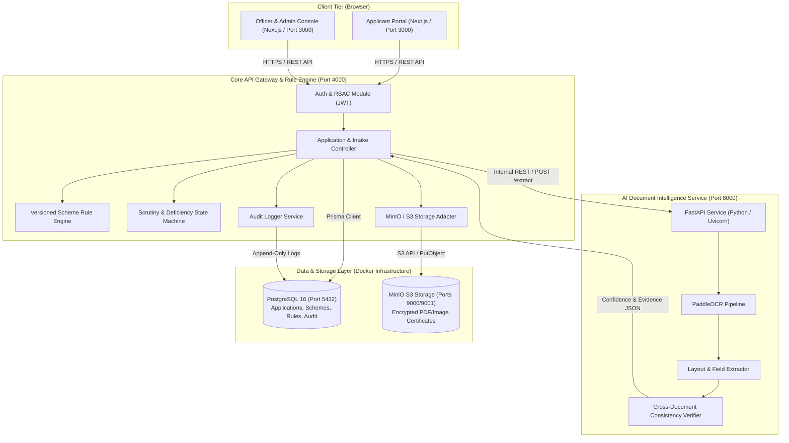
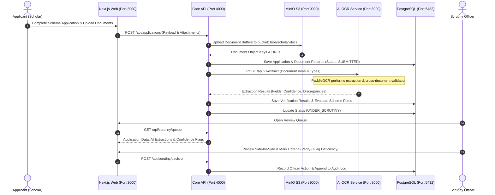

# TribalScholar AI: System Architecture

## 1. System Topology Overview



---

## 2. Monorepo Structure

```text
SIH26239/
├── .env.example                  # Consolidated environment variable contract
├── .gitignore                    # Root gitignore for TS, Python, and Docker
├── docker-compose.yml            # PostgreSQL 16 + MinIO S3 + MinIO Bucket Initializer
├── package.json                  # Root monorepo scripts (build, lint, test, docker:up/down)
├── pnpm-workspace.yaml           # pnpm workspace definition (apps, packages, services)
├── tsconfig.base.json            # Base strict TypeScript compiler options
├── PROJECT_CONTEXT.md            # Hackathon problem statement & project overview
├── ARCHITECTURE.md               # System architecture and data flow documentation
├── DEVELOPMENT_STATUS.md         # Phase tracking table & prompt completion log
├── HANDOFF.md                    # Cross-chat continuity notes & immediate instructions
│
├── apps/
│   ├── api/                      # Core Express + Prisma API (Port 4000)
│   │   ├── src/                  # Controllers, routes, services, rule engine
│   │   ├── prisma/               # Schema definitions and migrations
│   │   └── package.json
│   │
│   └── web/                      # Next.js 14+ Frontend (Port 3000)
│       ├── src/                  # App router pages, components, hooks
│       └── package.json
│
├── packages/
│   └── shared/                   # Shared TypeScript models, Zod schemas, DTOs
│       ├── src/                  # Common types, enums, validators
│       └── package.json
│
└── services/
    └── ai-ocr/                   # Python FastAPI OCR & Document Intelligence (Port 8000)
        ├── app/                  # FastAPI routers, OCR pipeline, validators
        ├── pyproject.toml        # uv / Python dependency definitions
        └── Dockerfile
```

---

## 3. Component Deep Dive

### 3.1. Frontend Web (`apps/web` - Next.js App Router)
- **Framework:** Next.js with Tailwind CSS, Lucide Icons, and React Hook Form.
- **Port:** `3000`.
- **Target Views:**
  1. *Public & Applicant Portal:* Scheme discovery, eligibility self-check, multi-step application form, document upload zone with format validation, deficiency correction interface.
  2. *Scrutiny Officer Workspace:* Split-screen review interface displaying extracted fields, side-by-side original PDF viewer, deficiency flagging checklist, and batch recommendation tools.
  3. *Selection & Admin Dashboard:* Scheme rule editor, quota & merit allocation monitors, user management, and system-wide audit explorer.

### 3.2. Core API & Rule Engine (`apps/api` - Node.js + Express + Prisma)
- **Framework:** Node.js with Express, Prisma ORM, and Zod validation.
- **Port:** `4000`.
- **Key Modules:**
  - `Auth & RBAC:` JWT-based authentication with bcrypt/argon2 hashing and role enforcement middlewares.
  - `Configurable Scheme Engine:` Dynamic rule evaluation executing JSON-defined eligibility conditions (age, income ceilings, marks thresholds, caste validity) for NFST and NOS.
  - `Workflow State Machine:` State management governing transitions: `DRAFT` → `SUBMITTED` → `UNDER_SCRUTINY` → `DEFICIENT` → `RESUBMITTED` → `SCRUTINY_VERIFIED` → `SELECTION_PENDING` → `PROVISIONALLY_SELECTED` / `REJECTED`.
  - `S3 Storage Client:` Presigned URL generator and document fetcher connecting to MinIO.
  - `AI Service Client:` HTTP adapter dispatching documents to `services/ai-ocr` and indexing extraction results.

### 3.3. AI OCR & Document Intelligence (`services/ai-ocr` - Python + FastAPI)
- **Framework:** FastAPI, Uvicorn, PaddleOCR.
- **Port:** `8000`.
- **Core Pipeline:**
  1. *Document Ingestion & Normalization:* Accepts PDF or image buffers, converts PDF pages to high-res images, handles de-skewing and orientation correction.
  2. *Text & Layout OCR:* PaddleOCR multi-lingual text detection and recognition.
  3. *Key Field Extraction:* Regular expressions and NER models to extract Aadhaar numbers, Certificate IDs, Names, Dates of Birth, Income figures, and Institute names.
  4. *Cross-Document Validation:* Fuzzy string matching (Levenshtein) and strict date comparisons checking identity consistency across uploaded documents.
  5. *Confidence Scoring:* Generates field-level confidence ratings ($0.0 - 1.0$) and identifies low-confidence fields for mandatory human officer attention.

### 3.4. Database & Storage Layer (Docker Infrastructure)
- **PostgreSQL 16:**
  - High-performance relational database with ACID compliance.
  - Port: `5432`.
  - Stores user credentials, scheme versions, application records, deficiency items, and tamper-evident audit trails.
- **MinIO S3-Compatible Storage:**
  - High-throughput object storage storing raw documents under `tribalscholar-docs` bucket.
  - Ports: `9000` (S3 API), `9001` (Web Console).
  - Secure isolated storage with automatic bucket bootstrapping.

---

## 4. End-to-End Application Lifecycle & Data Flow



---

## 5. Security & Governance Architecture
1. **Zero-Trust Network Principle:** Communication between Next.js, Core API, and Python OCR occurs through strictly typed DTOs and CORS restrictions.
2. **Role-Based Access Control (RBAC):** Middleware checks verify user tokens and enforce strict route permissions:
   - Applicants access only their own applications.
   - Scrutiny Officers cannot modify scheme definitions.
   - Administrators cannot alter historical audit logs.
3. **Audit Trail Integrity:** Immutable, timestamped audit log records every transition, user ID, IP address, previous state, new state, and rationale.
